<p align="center">
  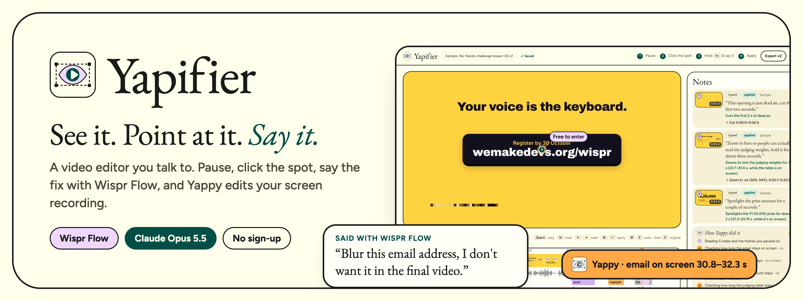
</p>

<p align="center">
  
  
  
  
</p>

<p align="center">
  <a href="https://yapifier.vercel.app"><b>Live demo</b></a> · <b>Demo video</b> (coming with the submission) · <a href="#try-it">Try it in 30 seconds</a> · <a href="#run-it-locally">Run it locally</a>
</p>

<p align="center">
  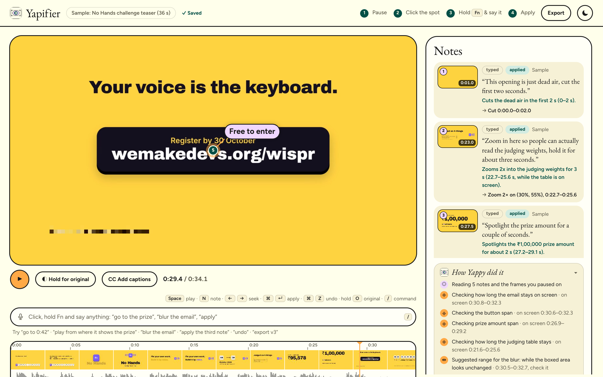
  <br><sub>Five notes, one Apply, 16 seconds. Every note shows the edit it really produced, and <i>How Yappy did it</i> lists what Yappy checked in the video first.</sub>
</p>

## The problem

I make product walkthroughs and demo videos at work. Recording one is quick. Polishing it isn't: scrubbing for the moment the dashboard loads, zooming into text nobody can read at 1080p, hiding an email or a customer name that slipped into the frame, cutting the pause where I hunted for a button. Then the review comes back: *"zoom in at 0:42"*, *"blur that at 1:10"*, *"the intro drags"*. Every comment is another trip through a timeline editor, with keyframes, masks and a mouse.

The fix is never hard to say. It's only hard to do.

**Yapifier makes saying it enough.** Pause where something's off, click the spot, hold Fn and say the fix with Wispr Flow. Yappy, the editing agent, looks at that frame, checks the footage around it like an editor scrubbing the timeline, and applies the edit. You watch the new version, fix anything that's almost right by hand, and export an MP4 with sound.

## Yapifier in 30 seconds

1. **See it.** Open a screen recording (or the sample). Play it and pause where something's off.
2. **Point at it.** Click the exact spot: a button, a line of small text, an email address.
3. **Say it.** Hold Fn and talk with Wispr Flow: *"zoom in here so people can read the weights"*, *"blur this email"*, *"cut this dead air"*, *"add a title card that says No Hands"*. Leave as many notes as you like.
4. **Yappy edits it.** Press Apply. Yappy checks the video around each note, applies every edit, and tells you what it did, or asks you a question back when a note can't be done as said.

<table>
  <tr>
    <td width="50%">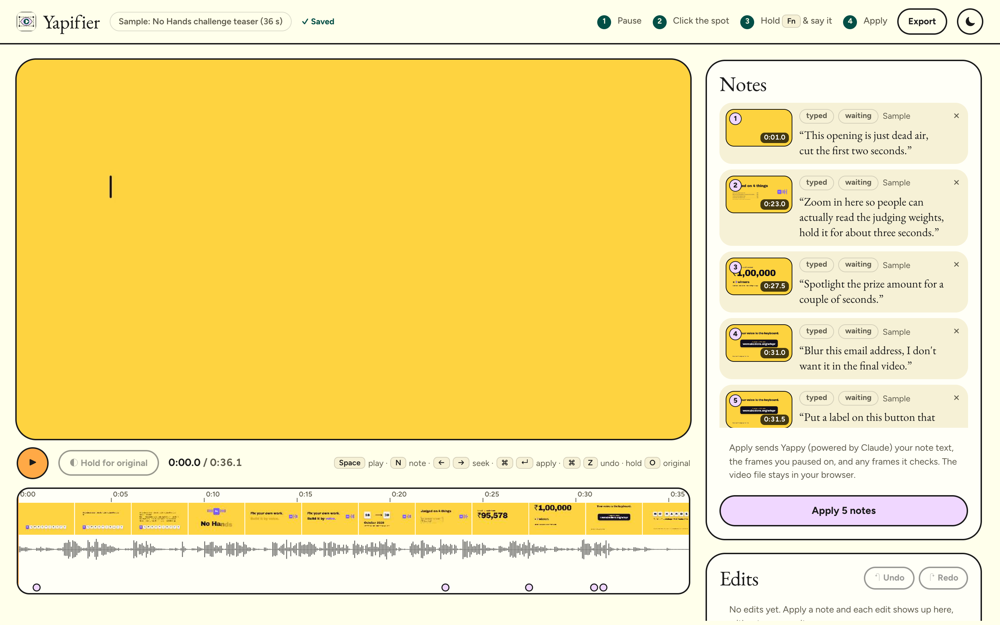<br><sub><b>Notes are pinned to a moment and a spot.</b> Each keeps the frame you paused on, so Yappy sees what you saw.</sub></td>
    <td width="50%">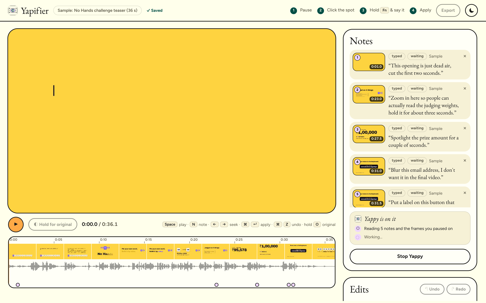<br><sub><b>Yappy is on it.</b> Its steps appear live: what it's checking, and what it found.</sub></td>
  </tr>
</table>

## Wispr Flow is the input

Take Flow out and Yapifier is a timeline editor with a text box. Every instruction in it is something you say:

| You say | Where | What happens |
|---|---|---|
| A note on a paused frame | the note box that opens where you click | Yappy turns it into edits: zoom, label, spotlight, blur, mask, cut, speed, freeze, title card, volume |
| An answer to Yappy's question | the answer box on a note that "needs you" | the note goes back to Yappy with your answer and it finishes the job |
| A follow-up | a new note on the same spot | *"make that label shorter"*, *"remove the zoom"*, *"keep the mask on for the whole video"* change the edits already there |

Speaking is faster than typing for this because a review comment is already a sentence. Pointing and talking together is what makes it precise: the click says *where* and *when*, the voice says *what*, and neither has to describe the other. Notes are often messy and sometimes in Hinglish; Yappy is prompted for exactly that.

Flow types a dictation in one go, the way a paste arrives, so each note is labelled **Flow or paste** or **typed**. Yapifier can't tell Flow from an ordinary paste, and says so rather than claiming to.

<!-- TODO before submitting: add the Wispr Flow usage card (Insights) as docs/media/wispr-usage.png and show it here. -->

## Meet Yappy

Yappy is the editor inside Yapifier: Claude Opus 5.5 with vision and two tools that run **in your browser**, on the original video. Your video file never leaves the page; Yappy asks for exactly the frames it needs.

<p align="center">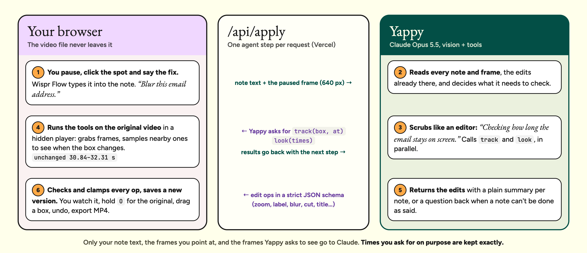</p>

- **`look(times)`** shows Yappy frames from up to six moments: where the dead air really ends, when an animation settles, what comes next.
- **`track(box, at)`** answers *"how long does this stay on screen?"*. The browser samples nearby frames (every half second, then narrowing down to about 0.03 s) and estimates when the content in that fixed box stops matching the frame you paused on. That's how a blur covers the time an email is visible, and not the next scene. It's an estimate for a box that stays put, so check it.
- **Every op is checked before it lands.** Claude's output is a strict JSON schema, then [`src/edit/ops.ts`](src/edit/ops.ts) validates and clamps each op (times inside the video, boxes inside the frame, sensible zoom and speed), refuses a cut that would remove the whole video, and gives every new blur a safety margin.
- **Your timing wins.** When you ask for timing on purpose (*"from 5 to 12 seconds"*, *"the whole video"*), Yappy marks it exact and it's kept as given. Otherwise a new overlay is fitted to the time its content looks unchanged, and the note tells you so.

<table>
  <tr>
    <td width="42%">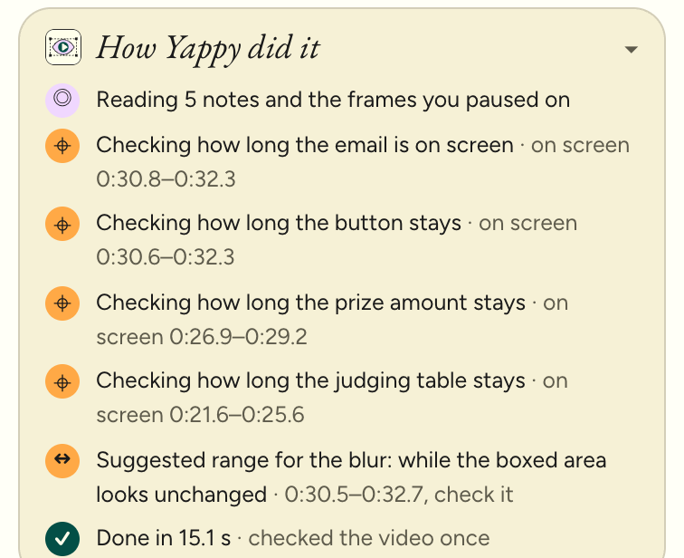</td>
    <td><b>Nothing is hidden.</b> After every Apply, <i>How Yappy did it</i> keeps the steps: which frames it looked at, which boxes it tracked and what it found, and anything Yapifier adjusted afterwards.<br><br>Each note then lists the edits it produced, with their final times and positions taken from the saved version, so you can check every reply against what was actually applied.</td>
  </tr>
</table>

## Almost right? Fix it by hand

Voice gets you 90% of the way. The last 10% shouldn't need another round trip.

<p align="center">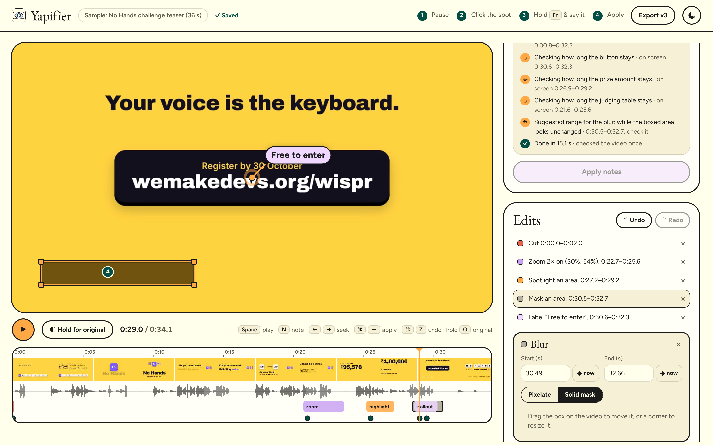</p>

- **Select any edit** in the Edits list or on the timeline, then drag its box on the video or a corner to resize it. Labels move by their dot; a zoom shows its window unzoomed so you can aim it.
- **Exact numbers** in the inspector: start and end (or *⌖ now* to use the playhead), label text, title and sub line, zoom, speed and volume.
- **Solid mask** for anything sensitive: an opaque patch in the area's own colour instead of pixelation.
- **All adjustments to one edit fold into one version**, so a single ⌘Z undoes them.

<table>
  <tr>
    <td width="50%">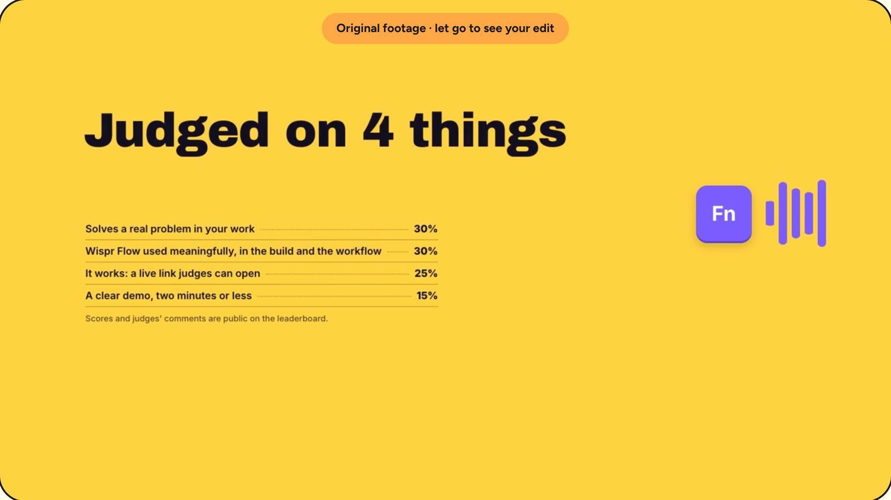<br><sub><b>Hold O</b> (or <i>Hold for original</i>) to see the untouched footage at the same moment…</sub></td>
    <td width="50%">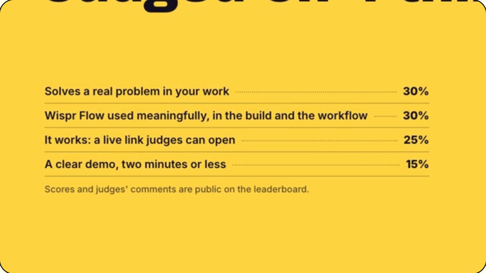<br><sub>…and let go to see your edit. Here: <i>"zoom in so people can read the judging weights"</i>.</sub></td>
  </tr>
</table>

## Nothing gets lost

- **Versions:** every Apply and every hand change is a new version. Jump back to any of them and restore it, or press ⌘Z / ⇧⌘Z.
- **Autosave:** notes, edits and versions are kept in your browser. Refresh or close the tab and Yapifier offers to pick up where you left off. An uploaded video is stored too when the browser has room; if not, it asks you to choose the same file again and checks it's the same one.
- **Export:** an MP4 with sound (WebM where MP4 isn't available), recorded from a frozen copy of the version you chose, so nothing you click mid-export changes it. You can stop an export, and stop Yappy, at any time.

<p align="center">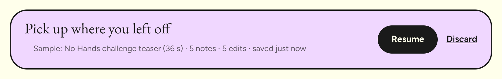</p>

<p align="center">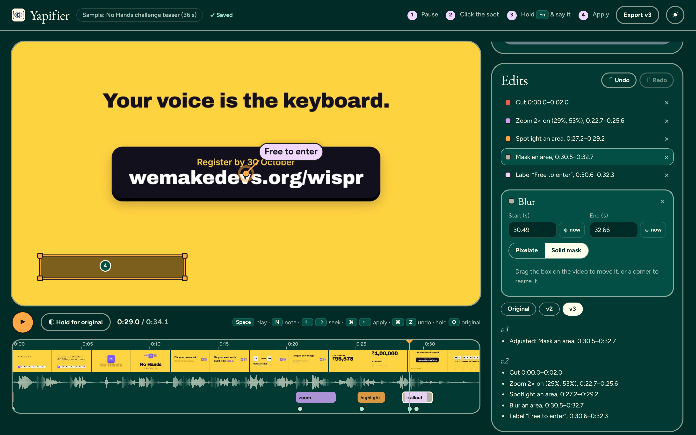</p>
<p align="center"><sub>The version history in dark mode: v2 is Yappy's five edits, v3 is one hand adjustment (the blur switched to a solid mask).</sub></p>

## What it can do

| Edit | Say something like | On screen |
|---|---|---|
| Zoom | *"zoom in so people can read this"* | a smooth zoom onto the spot, then back out |
| Label | *"put a label on this button that says Free to enter"* | a pill with a pointer dot |
| Spotlight | *"spotlight the prize amount"* | the area stays bright, the rest dims |
| Blur / mask | *"blur this email"* | pixelation or a solid mask, for as long as it's on screen |
| Cut | *"cut this dead air"* | the span is removed |
| Speed | *"speed this part up 2×"* | faster or slower playback for a span |
| Freeze | *"hold this frame for two seconds"* | the frame holds |
| Title card | *"add an intro card that says No Hands"* | an animated card before, between or after |
| Volume | *"mute this bit"* | quieter, louder or muted |

Yapifier never changes the pixels inside your footage: every edit is laid over it or around it. Ask for something it can't do (*"make the button red"*) and Yappy says so and offers the closest thing it can.

## What leaves your browser

| | Stays in your browser | Sent to Claude (Anthropic) |
|---|---|---|
| Your video file | ✓ | never |
| The frame you paused on | | as a 640 px JPEG, with your note |
| Other frames | | only the ones Yappy asks to see with `look`, at 480 px |
| Box tracking | ✓ runs locally | only the result ("unchanged from 30.8 s to 32.3 s") |
| Your note text | | ✓ (emails, key-like strings and phone numbers are redacted first) |
| Your project | ✓ autosaved locally | |

Note text is treated as data, not instructions: it reaches Claude inside `<note>` tags with a prompt that says so. The API has per-visitor and daily limits.

## Try it

**https://yapifier.vercel.app**, with no sign-up and nothing to install. Chrome or Edge works best (export needs them).

1. Press **Try it on a sample video**: a 36-second "No Hands" teaser made for this project, with five things left rough on purpose.
2. Pause, click and speak a note with Wispr Flow (typing works too). No mic? Press **Load 5 sample notes**.
3. Press **Apply** and watch Yappy work. Then select an edit to adjust it, hold **O** to compare, and **Export**.

Or upload your own recording: MP4 or WebM, up to 500 MB and 5 minutes.

<table>
  <tr>
    <td width="50%">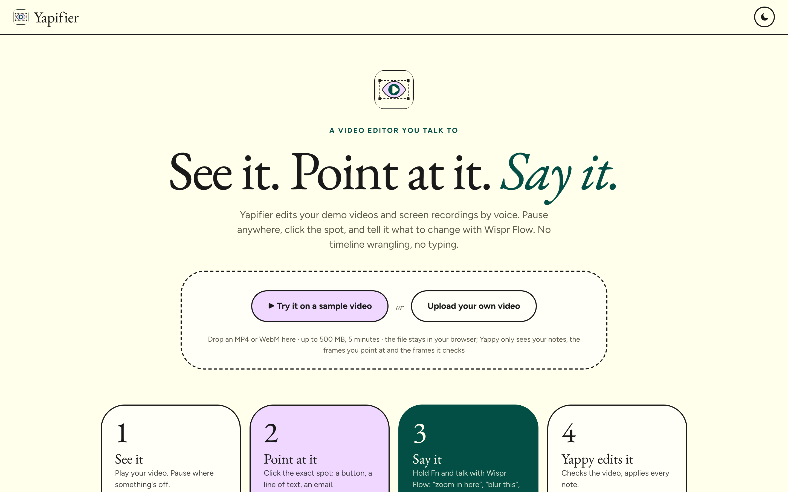</td>
    <td width="50%">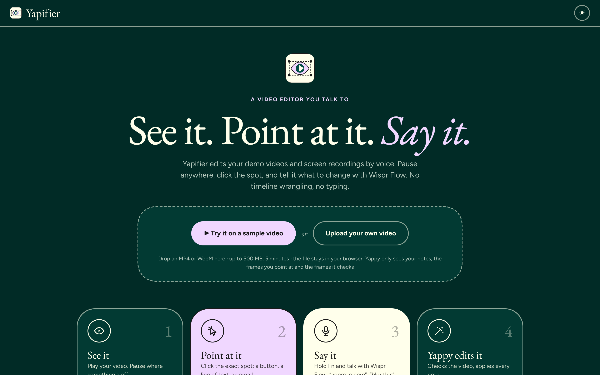</td>
  </tr>
</table>

### Run it locally

You need Node 22 and an Anthropic API key.

```bash
git clone https://github.com/Maulik176/Yapifier.git
cd Yapifier
npm install
echo "ANTHROPIC_API_KEY=sk-ant-..." > .env.local
npm run dev        # http://localhost:5173 (the API runs inside the dev server)
```

`npm run build` type-checks and builds for production. On Vercel, set `ANTHROPIC_API_KEY` in the project's environment variables; `api/apply.ts` serves the same handler.

## Numbers

Measured on the sample with its five notes (cut, zoom, spotlight, blur, label), live and locally, on Oct 24, 2026:

| | |
|---|---|
| One Apply, five notes, Claude included | 15.7–20.5 s, with one round of checking the video |
| Claude calls per Apply | 2 (one to plan and call tools, one to answer), 3 if an answer misses a note |
| Tracking the email box | estimated on screen 30.84–32.31 s; checked by hand on individual frames, it fades in at about 30.6 s and is gone by 32.2 s |
| Blur coverage after fitting | 30.49–32.66 s (padding covers the fade) |
| Export | real time: a 34-second edit takes about 34 seconds |

<details>
<summary><b>Under the hood</b></summary>

**The edit model.** Edits are data, never pixels: `{kind, start, end, x, y, w, h, …}` in source seconds and fractions of the frame. [`src/edit/timeline.ts`](src/edit/timeline.ts) turns cuts, speed changes, freezes and title cards into play/hold segments; [`src/edit/render.ts`](src/edit/render.ts) paints each output frame on a canvas (zoom window, pixelation or mask, spotlight, labels, spring-animated title cards); [`src/edit/player.ts`](src/edit/player.ts) drives a hidden `<video>` through those segments and routes audio through Web Audio for volume edits and recording.

**The agent loop.** [`server/apply.ts`](server/apply.ts) is one agent step per request. The browser sends the notes and the run so far; the server calls Claude with the tools and a strict JSON schema for the answer, and returns either tool calls or results. Assistant turns go back unchanged and the first message is rebuilt identically each step, so the history only ever grows. [`src/edit/agent.ts`](src/edit/agent.ts) runs the tools; [`src/edit/track.ts`](src/edit/track.ts) reads frames and grayscale patches from a second hidden video. Only the first step of a run counts as an apply for rate limits; transcripts are validated (our tools only, text and JPEG results only, bounded size).

**Safety nets.** Media waits time out with a clear message (no hanging on a file the browser can't decode). A WebM copy of the sample serves browsers without H.264. More than eight notes go in batches. A run can be stopped and has a deadline; an export stops on recorder errors or stalled playback.

| Path | What |
|---|---|
| `src/App.tsx` | the editor: notes, Apply, versions, undo, export, save and resume |
| `src/edit/` | the engine: types, timeline, ops (validation), render, player, media, track, agent, sample |
| `src/components/` | Landing, Stage, Timeline, Panels, Inspector, EditHandles, NotePopover |
| `src/save.ts` | autosave in IndexedDB |
| `server/apply.ts`, `api/apply.ts` | the agent step and its Vercel wrapper |
| `sample-video/` | the HyperFrames project that renders the sample |
| `docs/media/` | README images; `src/` has the screenshot script (`node docs/media/src/screenshots.mjs docs/media`) and the banner and diagram sources (`sh docs/media/src/render.sh`) |
</details>

## How I built it

Solo, in about a week, and mostly by voice. I dictated the specs, reviews and decisions through Wispr Flow to Claude Code, which wrote most of the code from them. I owned the product, the design and every decision below, and tested each flow in the browser before it shipped.

- **Point, then speak.** The click carries *where* and *when*; the voice only carries *what*. That's why short, messy notes work.
- **Edits are data over the footage, never new pixels.** Every edit can be adjusted, undone, compared and exported, and nothing is lost by changing your mind.
- **The model proposes, the code decides.** Claude returns ops in a strict schema; `ops.ts` validates and clamps every one before it reaches the screen.
- **Tools run where the video is.** Tracking and frame grabs happen in the browser, so the file never uploads and Claude sees only what it asks for.
- **Say what was really done.** Results shown on a note are worked out from the final edits; uncertainty is labelled ("suggested range… check it").
- **Correction is part of the product.** An almost-right edit should take one drag, not another prompt.

| Layer | Choice |
|---|---|
| Voice | Wispr Flow (dictation into the note and answer boxes) |
| Agent | Claude Opus 5.5 via the Anthropic SDK: vision, tools, strict JSON output, server-side refusal fallback |
| App | React 19, TypeScript, Vite; canvas rendering, Web Audio, MediaRecorder, IndexedDB |
| API and hosting | a Vercel function (`api/apply.ts`) and static hosting |
| Sample video | HyperFrames (HTML rendered to video), Kokoro voice-over |

## Honest limits

- **Tracking follows a fixed box, not a moving object.** It tells you how long the content inside a box stays as it is. Scrolling or moving content ends the edit early; check it, and widen the box or the times by hand. Real object tracking is next.
- **Export is real time** and needs Chrome or Edge with the tab in front.
- **Rate limits live in each server instance**, not across all of them; the Anthropic account's spend limit is the hard cap.
- Tested on Chrome on macOS, mostly with the sample video; not yet on Safari, Windows or 4K footage.

## What's next

- Follow moving content (cursor, scrolling) for blurs and labels.
- A shareable review link: reviewers leave spoken notes on your video, you apply them in one go.
- Faster-than-real-time export.

## Credits

Built by **Maulik Ranadive** for *No Hands: The Wispr Challenge* by WeMakeDevs × Wispr Flow. Not an official Wispr Flow product. The sample teaser was made for this project with HyperFrames and is not an official WeMakeDevs or Wispr Flow video.
