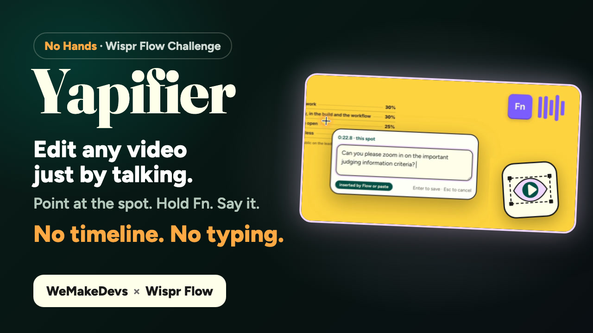
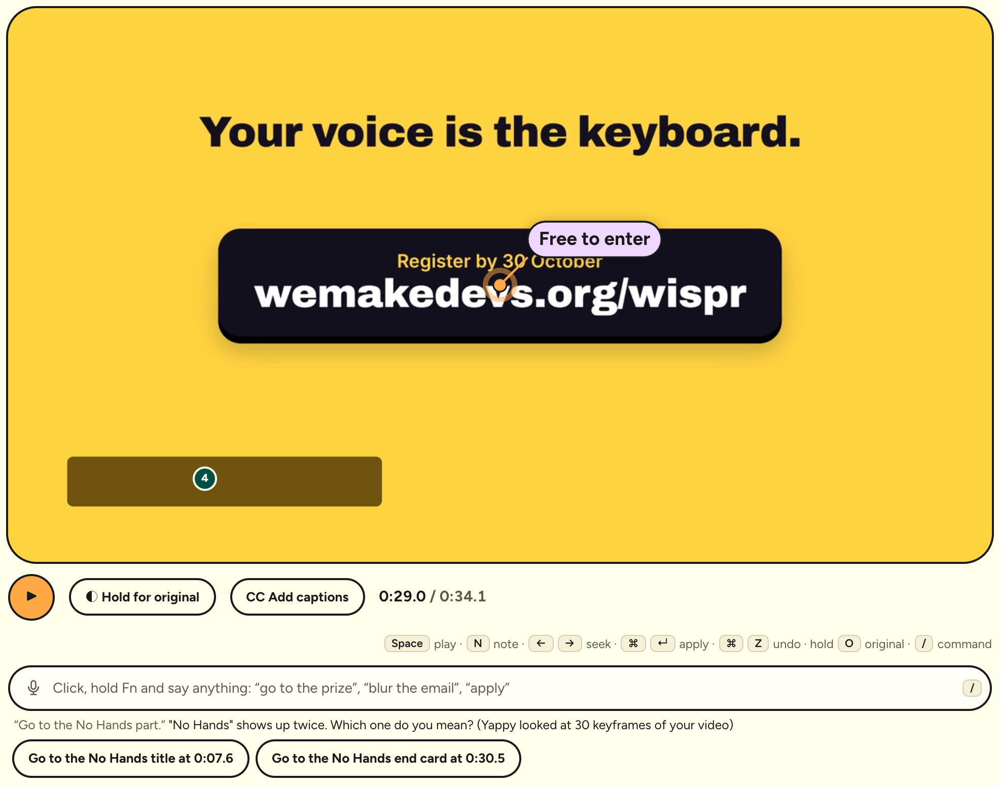
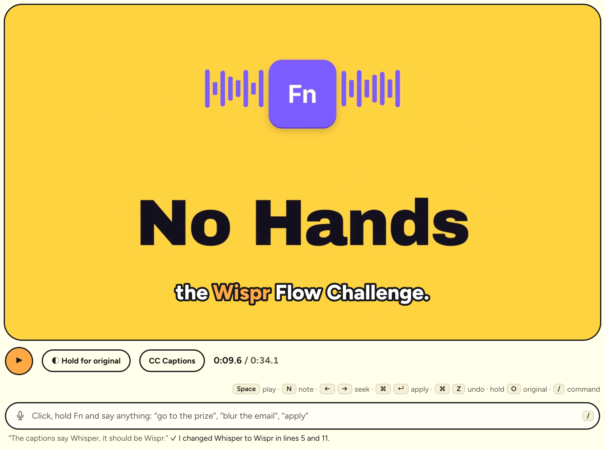
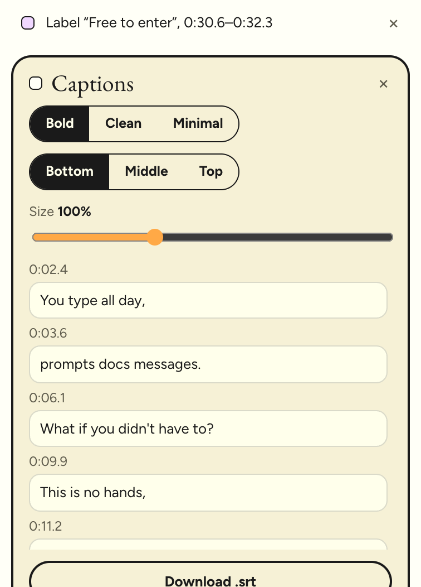

<p align="center">
  
</p>

<p align="center">
  
  
  
  
</p>

<p align="center">
  <a href="https://yapifier.vercel.app"><b>Live demo</b></a> · <a href="https://youtu.be/ExVRB296H3s"><b>Demo video</b></a> · <a href="#try-it">Try it in 30 seconds</a> · <a href="#run-it-locally">Run it locally</a>
</p>

<p align="center">
  
  <br><sub>Five notes, one Apply, 16 seconds. Every note shows the edit it really produced, and <i>How Yappy did it</i> lists what Yappy checked in the video first.</sub>
</p>

## The problem

I make product walkthroughs and demo videos at work. Recording one is quick. Polishing it isn't: scrubbing for the moment the dashboard loads, zooming into text nobody can read at 1080p, hiding an email or a customer name that slipped into the frame, cutting the pause where I hunted for a button. Then the review comes back: *"zoom in at 0:42"*, *"blur that at 1:10"*, *"the intro drags"*. Every comment is another trip through a timeline editor, with keyframes, masks and a mouse.

The fix is never hard to say. It's only hard to do. The four fixes in my demo video take me **30–45 minutes by hand in CapCut**. In Yapifier, by voice, they took **under 5 minutes**.

**Yapifier makes saying it enough.** Pause where something's off, click the spot, hold Fn and say the fix with Wispr Flow. Yappy, the editing agent, looks at that frame, checks the footage around it like an editor scrubbing the timeline, and applies the edit. You watch the new version, fix anything that's almost right by hand, and export an MP4 with sound.

And you don't have to click at all. Say *"go to where it shows ₹1 lakh"*, *"blur the email"*, *"add captions"* or *"export v3"* into the command bar, and Yappy finds the moment, makes the change, or asks you which one you meant.

## Watch the demo

<p align="center">
  <a href="https://youtu.be/ExVRB296H3s"></a>
  <br><sub>3:51 on YouTube: the raw video, four fixes dictated with Wispr Flow, Yappy at work, one edit fixed by hand, and the export.</sub>
</p>

## Yapifier in 30 seconds

1. **See it.** Open a screen recording (or the sample). Play it and pause where something's off.
2. **Point at it.** Click the exact spot: a button, a line of small text, an email address.
3. **Say it.** Hold Fn and talk with Wispr Flow: *"zoom in here so people can read the weights"*, *"blur this email"*, *"cut this dead air"*, *"add a title card that says No Hands"*. Leave as many notes as you like.
4. **Yappy edits it.** Press Apply. Yappy checks the video around each note, applies every edit, and tells you what it did, or asks you a question back when a note can't be done as said.

<table>
  <tr>
    <td width="50%"><br><sub><b>Notes are pinned to a moment and a spot.</b> Each keeps the frame you paused on, so Yappy sees what you saw.</sub></td>
    <td width="50%"><br><sub><b>Yappy is on it.</b> Its steps appear live: what it's checking, and what it found.</sub></td>
  </tr>
</table>

## Talk to the timeline

Press **/** (or click the bar under the video), hold Fn and say anything. Exact commands run instantly in your browser: *"pause"*, *"go to 0:42"*, *"back 5 seconds"*, *"undo"*, *"export v2"*. Everything else goes to Yappy, which reads a short summary of your edit and answers with editor actions.

<table>
  <tr>
    <td width="50%"><br><sub><b>Find things by what's on screen.</b> Yappy looks through one small frame per scene of your video and knows ₹1 lakh is the ₹1,00,000 on the slide.</sub></td>
    <td width="50%"><br><sub><b>Unclear? It asks.</b> "No Hands" appears twice, so Yappy offers both as buttons instead of guessing.</sub></td>
  </tr>
</table>

| Say | What happens |
|---|---|
| *"play from the part with the judging table"*, *"go to the next note"* | moves the playhead, by time, note, edit or what's on screen |
| *"apply the third note"*, *"apply everything except the zoom"* | applies just those notes |
| *"speed this up to 2x for 5 seconds"*, *"blur the email"* | makes the edit right away, no click needed |
| *"remove the zoom and show me the original"* | several steps in one breath |
| *"show v2"*, *"export the version before this one"*, *"restore the one with the zoom"* | versions and export |
| *"how long is the video now?"* | an answer, no change |
| *"make the background blue"* | Yappy says it can't recolour footage and offers what it can do |

A test set of **113 phrases** people might say (Hinglish, several steps at once, unclear requests, things it can't do) checks how Yappy *interprets* each one: whether it picks the right editor actions, not whether the finished edit is perfect. It picks the right ones for **112**, in a median of 2.7 seconds (see [Numbers](#numbers)).

## Captions

<table>
  <tr>
    <td width="62%"></td>
    <td><b>Captions from the speech, fixed by voice.</b> Click <b>CC Add captions</b> or say <i>"add captions"</i>. The transcriber heard "Whisper Flow"; one sentence fixed every line with it.<br><br>Say <i>"translate the captions to Hindi"</i>, <i>"make them bigger"</i>, <i>"put them at the top"</i> or <i>"turn off the subtitles"</i>. Bold lights up each word as it's said; Clean and Minimal are calmer.</td>
  </tr>
</table>

- **Transcribed in your browser.** Uploads go through Whisper running on your machine, in a background thread, so the video keeps playing smoothly while it listens and the captions just appear when they're ready. The audio never leaves the page. The first time, the browser downloads the speech model once (about 80 MB); after that it loads from the cache. The sample's captions are ready instantly.
- **Part of the edit.** Captions are a version like any other edit: undo, compare, and burned into the export. Every line can be fixed by hand, and **Download .srt** gives a subtitle file timed to your edited video (lines move with your cuts).

<p align="center"></p>

## Wispr Flow is the input

Take Flow out and Yapifier is a timeline editor with a text box. Every instruction in it is something you say:

| You say | Where | What happens |
|---|---|---|
| A note on a paused frame | the note box that opens where you click | Yappy turns it into edits: zoom, label, spotlight, blur, mask, cut, speed, freeze, title card, volume |
| An answer to Yappy's question | the answer box on a note that "needs you" | the note goes back to Yappy with your answer and it finishes the job |
| A follow-up | a new note on the same spot | *"make that label shorter"*, *"remove the zoom"*, *"keep the mask on for the whole video"* change the edits already there |
| A command | the command bar (press **/**) | moves around, applies notes, makes edits, switches and exports versions |
| A caption fix | the command bar | *"it says Whisper, it should be Wispr"* fixes every line with that word; *"translate them to Hindi"* rewrites them all |

Speaking is faster than typing for this because a review comment is already a sentence. Pointing and talking together is what makes it precise: the click says *where* and *when*, the voice says *what*, and neither has to describe the other. Notes are often messy and sometimes in Hinglish; Yappy is prompted for exactly that.

Flow types a dictation in one go, the way a paste arrives, so each note is labelled **Flow or paste** or **typed**. Yapifier can't tell Flow from an ordinary paste, and says so rather than claiming to.

## Meet Yappy

Yappy is the editor inside Yapifier: an AI agent with vision and two tools that run **in your browser**, on the original video. Your video file never leaves the page; Yappy asks for exactly the frames it needs.

<p align="center"></p>

- **`look(times)`** shows Yappy frames from up to six moments: where the dead air really ends, when an animation settles, what comes next.
- **`track(box, at)`** answers *"how long does this stay on screen?"*. The browser samples nearby frames (every half second, then narrowing down to about 0.03 s) and estimates when the content in that fixed box stops matching the frame you paused on. That's how a blur covers the time an email is visible, and not the next scene. It's an estimate for a box that stays put, so check it.
- **Every op is checked before it lands.** Yappy answers in a strict JSON schema, then [`src/edit/ops.ts`](src/edit/ops.ts) validates and clamps each op (times inside the video, boxes inside the frame, sensible zoom and speed), refuses a cut that would remove the whole video, and gives every new blur a safety margin.
- **Your timing wins.** When you ask for timing on purpose (*"from 5 to 12 seconds"*, *"the whole video"*), Yappy marks it exact and it's kept as given. Otherwise a new overlay is fitted to the time its content looks unchanged, and the note tells you so.

<table>
  <tr>
    <td width="42%"></td>
    <td><b>Nothing is hidden.</b> After every Apply, <i>How Yappy did it</i> keeps the steps: which frames it looked at, which boxes it tracked and what it found, and anything Yapifier adjusted afterwards.<br><br>Each note then lists the edits it produced, with their final times and positions taken from the saved version, so you can check every reply against what was actually applied.</td>
  </tr>
</table>

## Almost right? Fix it by hand

Voice gets you 90% of the way. The last 10% shouldn't need another round trip.

<p align="center"></p>

- **Select any edit** in the Edits list or on the timeline, then drag its box on the video or a corner to resize it. Labels move by their dot; a zoom shows its window unzoomed so you can aim it.
- **Exact numbers** in the inspector: start and end (or *⌖ now* to use the playhead), label text, title and sub line, zoom, speed and volume.
- **Solid mask** for anything sensitive: an opaque patch in the area's own colour instead of pixelation.
- **All adjustments to one edit fold into one version**, so a single ⌘Z undoes them.

<table>
  <tr>
    <td width="50%"><br><sub><b>Hold O</b> (or <i>Hold for original</i>) to see the untouched footage at the same moment…</sub></td>
    <td width="50%"><br><sub>…and let go to see your edit. Here: <i>"zoom in so people can read the judging weights"</i>.</sub></td>
  </tr>
</table>

## Nothing gets lost

- **Versions:** every Apply and every hand change is a new version. Jump back to any of them and restore it, or press ⌘Z / ⇧⌘Z.
- **Autosave:** notes, edits and versions are kept in your browser. Refresh or close the tab and Yapifier offers to pick up where you left off. An uploaded video is stored too when the browser has room; if not, it asks you to choose the same file again and checks it's the same one.
- **Export:** an MP4 with sound (WebM where MP4 isn't available), recorded from a frozen copy of the version you chose, so nothing you click mid-export changes it. You can stop an export, and stop Yappy, at any time.

<p align="center"></p>

<p align="center"></p>
<p align="center"><sub>The version history in dark mode: v2 is Yappy's five edits, v3 is one hand adjustment (the blur switched to a solid mask).</sub></p>

## What it can do

| Edit | Say something like | On screen |
|---|---|---|
| Zoom | *"zoom in so people can read this"* | a smooth zoom onto the spot, then back out |
| Label | *"put a label on this button that says Free to enter"* | a pill with a pointer dot |
| Spotlight | *"spotlight the prize amount"* | the area stays bright, the rest dims |
| Blur / mask | *"blur this email"* | pixelation or a solid mask, for as long as it's on screen |
| Cut | *"cut this dead air"* | the span is removed |
| Speed | *"speed this part up 2×"* | faster or slower playback for a span |
| Freeze | *"hold this frame for two seconds"* | the frame holds |
| Title card | *"add an intro card that says No Hands"* | an animated card before, between or after |
| Volume | *"mute this bit"* | quieter, louder or muted |
| Captions | *"add captions"*, *"captions in Hindi"* | the speech as captions, with the spoken word lit up |

Yapifier never changes the pixels inside your footage: every edit is laid over it or around it. Ask for something it can't do (*"make the button red"*) and Yappy says so and offers the closest thing it can.

## What leaves your browser

| | Stays in your browser | Sent to Yappy |
|---|---|---|
| Your video file | ✓ | never |
| The frame you paused on | | as a 640 px JPEG, with your note |
| Other frames | | only the ones Yappy asks to see with `look`, at 480 px |
| Box tracking | ✓ runs locally | only the result ("unchanged from 30.8 s to 32.3 s") |
| Your note text | | ✓ (emails, key-like strings and phone numbers are redacted first) |
| An exact command (*"pause"*, *"go to 0:42"*, *"undo"*, *"export v2"*) | ✓ handled in your browser | nothing |
| A spoken command that Yappy answers | | the words, the last few commands, and a text summary of the edit: times, notes, edits, versions and, once you have captions, their lines |
| Finding things on screen | | one 320 px frame per scene of the original video. They're first sent when a command needs to find something (the bar says so), and from then on they go with every command Yappy answers about that video |
| Audio, for captions | ✓ transcribed on your machine | never |
| Caption text | | once captions exist, their lines are part of that text summary for every command Yappy answers, not only caption fixes |
| Your project | ✓ autosaved locally | |

Yappy's AI runs through a third-party model provider's API, which receives only what's in the right-hand column. What you say is treated as data, not instructions: it reaches the model inside `<note>` or `<said>` tags with a prompt that says so. The API has per-visitor and daily limits.

## Try it

**https://yapifier.vercel.app**, with no sign-up and nothing to install. Chrome or Edge works best (export needs them).

1. Press **Try it on a sample video**: a 36-second "No Hands" teaser made for this project, with five things left rough on purpose.
2. Pause, click and speak a note with Wispr Flow (typing works too). No mic? Press **Load 5 sample notes**.
3. Press **Apply** and watch Yappy work. Then select an edit to adjust it, hold **O** to compare, and **Export**.
4. Press **/** and say (or type) *"take me to where it shows ₹1 lakh"*. Then click **CC Add captions** and say *"the captions say Whisper, it should be Wispr"*.

Or upload your own recording: MP4 or WebM, up to 500 MB and 5 minutes.

<table>
  <tr>
    <td width="50%"></td>
    <td width="50%"></td>
  </tr>
</table>

### Run it locally

You need Node 22 and an Anthropic API key.

```bash
git clone https://github.com/Maulik176/Yapifier.git
cd Yapifier
npm install
echo "ANTHROPIC_API_KEY=sk-ant-..." > .env.local
npm run dev        # http://localhost:5173 (the API runs inside the dev server)
```

`npm run build` type-checks and builds for production, and `npm test` runs the unit tests. On Vercel, set `ANTHROPIC_API_KEY` in the project's environment variables; `api/apply.ts` and `api/talk.ts` serve the same handlers.

`node evals/talk/run.mjs` runs the command bar's 113-phrase test set against the live API and prints how many phrases it interprets correctly, speed and cost (about $0.60 a run).

## Numbers

**The four fixes in the demo video:** about 30–45 minutes by hand in CapCut, under 5 minutes in Yapifier (my own runs).

Measured on the sample with its five notes (cut, zoom, spotlight, blur, label), live and locally, on Oct 24, 2026:

| | |
|---|---|
| One Apply, five notes, AI included | 15.7–20.5 s, with one round of checking the video |
| Model calls per Apply | 2 (one to plan and call tools, one to answer), 3 if an answer misses a note |
| Tracking the email box | estimated on screen 30.84–32.31 s; checked by hand on individual frames, it fades in at about 30.6 s and is gone by 32.2 s |
| Blur coverage after fitting | 30.49–32.66 s (padding covers the fade) |
| Export | real time: a 34-second edit takes about 34 seconds |

**The command bar,** measured on Oct 30, 2026 against my own test set of 113 phrases on the sample (`evals/talk`). It measures interpretation (did Yappy choose the right editor actions?), not finished edits; those run through the same apply step as notes, and the export is checked below.

| | |
|---|---|
| Interpreted correctly | 112 of 113. The miss: *"play from where the keyboard shows up"* starts at 0:00, about 2 s before the keyboard appears |
| Paused finds | land on a frame that shows the thing: *"go to where the prize is shown"* → 0:27.7, the ₹1,00,000 slide |
| Handled instantly in the browser, no AI call | 25 of 113 |
| Speed when Yappy answers | median 2.7 s, 90% within 4.1 s |
| Cost | about 0.7¢ per command sent to Yappy |
| A smaller, cheaper model | 92 of 99, but asked to blur the email it blurred the words "client email" instead, so Yappy stays on the stronger one |

**Captions** on the 36-second sample, uploaded as a file:

| | |
|---|---|
| First time in a browser | downloads the speech model once (about 80 MB) |
| After that | captioned in 13–18 s, all in the browser |
| Playback while it works | no main-thread task over 50 ms (before the background thread: one 12.4 s freeze) |
| If it stalls | loading that shows no progress for a minute, or transcribing past its time limit, stops with a clear message; click CC to try again, or click it while it works to stop |

**An exported video, checked frame by frame:** the sample with its five notes applied and captions on, saved by saying *"export"*: 34.3 s of H.264 video with AAC sound (mean −18.9 dB), with the captions, the zoom, the spotlight, the *Free to enter* label and the pixelated email all in the file.

<details>
<summary><b>Under the hood</b></summary>

**The edit model.** Edits are data, never pixels: `{kind, start, end, x, y, w, h, …}` in source seconds and fractions of the frame. [`src/edit/timeline.ts`](src/edit/timeline.ts) turns cuts, speed changes, freezes and title cards into play/hold segments; [`src/edit/render.ts`](src/edit/render.ts) paints each output frame on a canvas (zoom window, pixelation or mask, spotlight, labels, spring-animated title cards); [`src/edit/player.ts`](src/edit/player.ts) drives a hidden `<video>` through those segments and routes audio through Web Audio for volume edits and recording.

**The agent loop.** [`server/apply.ts`](server/apply.ts) is one agent step per request. The browser sends the notes and the run so far; the server calls the model with the tools and a strict JSON schema for the answer, and returns either tool calls or results. Assistant turns go back unchanged and the first message is rebuilt identically each step, so the history only ever grows. [`src/edit/agent.ts`](src/edit/agent.ts) runs the tools; [`src/edit/track.ts`](src/edit/track.ts) reads frames and grayscale patches from a second hidden video. Only the first step of a run counts as an apply for rate limits; transcripts are validated (our tools only, text and JPEG results only, bounded size).

**The command bar.** [`src/edit/commands.ts`](src/edit/commands.ts) parses exact commands in the browser; anything else goes to [`server/talk.ts`](server/talk.ts), one step per request, with a short text snapshot of the editor (never frames). Yappy answers with editor actions in a strict schema, which [`src/edit/talk.ts`](src/edit/talk.ts) turns into the same commands. To find something on screen it asks for a keyframe strip: [`src/edit/scenes.ts`](src/edit/scenes.ts) samples the video and keeps one frame per scene. The strip goes first in later requests, so it's read from the prompt cache.

**Captions.** [`src/edit/whisper.worker.ts`](src/edit/whisper.worker.ts) runs Whisper (transformers.js, the model from Hugging Face) in a Web Worker; [`src/edit/captions.ts`](src/edit/captions.ts) groups the words into short lines, keeps word timing for the highlight, and writes the .srt through the edit's timeline. Captions are an edit kind, so versions, undo and export carry them, but the editing agent's ops can't create them.

**Safety nets.** Media waits time out with a clear message (no hanging on a file the browser can't decode). A WebM copy of the sample serves browsers without H.264. More than eight notes go in batches. A run can be stopped and has a deadline; an export stops on recorder errors or stalled playback.

| Path | What |
|---|---|
| `src/App.tsx` | the editor: notes, Apply, versions, undo, export, save and resume |
| `src/edit/` | the engine: types, timeline, ops (validation), render, player, media, track, agent, sample, commands, talk, scenes, captions, transcribe and the Whisper worker |
| `src/components/` | Landing, Stage, Timeline, Panels, Inspector, EditHandles, NotePopover, CommandBar |
| `src/save.ts` | autosave in IndexedDB |
| `server/apply.ts`, `api/apply.ts` | the agent step for notes, and its Vercel wrapper |
| `server/talk.ts`, `api/talk.ts` | the command bar's agent step, and its Vercel wrapper |
| `tests/`, `evals/talk/` | unit tests (`npm test`) and the command bar's 113-phrase test set |
| `sample-video/` | the HyperFrames project that renders the sample |
| `docs/media/` | README images; `src/` has the screenshot script (`node docs/media/src/screenshots.mjs docs/media`) and the banner and diagram sources (`sh docs/media/src/render.sh`) |
</details>

## How I built it

Solo, in about a week, and mostly by voice. I dictated the specs, reviews and decisions through Wispr Flow to Claude Code, which wrote most of the code from them. I owned the product, the design and every decision below, and tested each flow in the browser before it shipped.

- **Point, then speak.** The click carries *where* and *when*; the voice only carries *what*. That's why short, messy notes work.
- **Edits are data over the footage, never new pixels.** Every edit can be adjusted, undone, compared and exported, and nothing is lost by changing your mind.
- **The model proposes, the code decides.** Yappy returns ops in a strict schema; `ops.ts` validates and clamps every one before it reaches the screen.
- **Tools run where the video is.** Tracking and frame grabs happen in the browser, so the file never uploads and Yappy sees only what it asks for.
- **Say what was really done.** Results shown on a note are worked out from the final edits; uncertainty is labelled ("suggested range… check it").
- **Correction is part of the product.** An almost-right edit should take one drag, not another prompt.
- **People say anything, so measure it.** The command bar began as a list of phrases, and real phrasing broke it within minutes. Now Yappy works out what you meant, and a 113-phrase test set checks every change for how well it understands, how fast, and at what cost.
- **Never stall the video.** Heavy work (transcription, tracking) runs off the main thread or in short steps, so playback stays smooth while it happens.

The later features each landed as their own pull request with tests and the eval numbers: [voice commands](https://github.com/Maulik176/Yapifier/pull/1) and [captions](https://github.com/Maulik176/Yapifier/pull/2).

| Layer | Choice |
|---|---|
| Voice | Wispr Flow (dictation into the note, answer and command boxes) |
| Captions | Whisper in the browser (transformers.js, in a Web Worker) |
| Agent | Yappy: a vision model with tool use and strict JSON output, called one step at a time from a serverless function |
| App | React 19, TypeScript, Vite; canvas rendering, Web Audio, MediaRecorder, IndexedDB |
| API and hosting | Vercel functions (`api/apply.ts`, `api/talk.ts`) and static hosting |
| Sample video | HyperFrames (HTML rendered to video), Kokoro voice-over |

## Honest limits

- **Tracking follows a fixed box, not a moving object.** It tells you how long the content inside a box stays as it is. Scrolling or moving content ends the edit early; check it, and widen the box or the times by hand. Real object tracking is next.
- **Export is real time** and needs Chrome or Edge with the tab in front.
- **Finding things on screen** works from one frame per scene. Paused finds land on a frame that shows the thing; *"play from…"* can start a moment before it appears.
- **Captions on uploads** need a one-time 80 MB download per browser, and the transcriber can mishear names and Hinglish (it wrote "lack" for "lakh"); fix those by voice or by hand. Turning captions off removes them; *"undo"* brings them back.
- **Rate limits live in each server instance**, not across all of them; the AI provider account's spend limit is the hard cap.
- Tested on Chrome on macOS, mostly with the sample video; not yet on Safari, Windows or 4K footage.

## What's next

- Reframe for Reels, Shorts and LinkedIn (9:16, 1:1, 4:5), following where the action is on screen.
- Publish straight to YouTube, LinkedIn or Slack from the export dialog.
- Follow moving content (cursor, scrolling) for blurs and labels.
- A shareable review link: reviewers leave spoken notes on your video, you apply them in one go.
- Faster-than-real-time export.

## Credits

Built by **Maulik Ranadive** for *No Hands: The Wispr Challenge* by WeMakeDevs × Wispr Flow. Not an official Wispr Flow product. The sample teaser was made for this project with HyperFrames and is not an official WeMakeDevs or Wispr Flow video.
